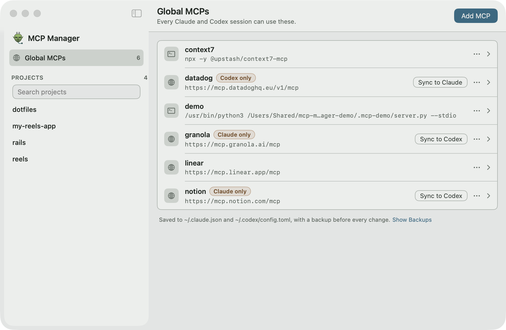

# MCP Manager

A macOS menu bar app that keeps your MCP servers in step across **Claude Code** and **Codex**. Themed with the Orc design system.

<picture>
  <source media="(prefers-color-scheme: dark)" srcset="assets/screenshots/main-window-dark.png">
  
</picture>

- **Global MCPs:** add, edit, rename and remove. Adding writes to Claude and Codex at the same time. A server that only one client has is flagged "Claude only" or "Codex only", with a **Sync** button.
- **Project MCPs:** fuzzy-search any project Claude or Codex knows about (type `reels`, `rls`, …), see every MCP configured for it, and edit or remove each one in the file it came from.
- **MCP client:** open any server to connect to it, list its tools, call them with a generated form or raw JSON, read its resources and prompts, and read a log of every message. Works over stdio, Streamable HTTP and SSE, signs in to OAuth servers, and explains failures with the fix.
- **Menu bar:** quick list, sync, project search, and shortcuts into the full window.

## Install and open

```sh
./install.sh        # builds the app, installs it to ~/Applications, adds `mcp-manager` to ~/.local/bin
mcp-manager open    # launches MCP Manager (if needed) and shows its window
bin/test            # core tests (real temp files, no mocks)
```

`./install.sh --build-only` stops after building `build/MCP Manager.app`. Set `MCP_MANAGER_BIN_DIR` to put the command somewhere other than `~/.local/bin`.

SwiftPM is not used. Everything compiles with plain `swiftc` (macOS 14+, Command Line Tools are enough).

To try the app without touching your real configs, point it at a throwaway home:

```sh
MCP_MANAGER_HOME="$(bin/fixture-home "$(mktemp -d)")" mcp-manager open
```

Quit any running copy first: the home is only read at launch. The fixture home has a working `demo` server to connect to, and a `reels` project server whose variable is not set.

## Screenshots in the background

```sh
bin/capture /tmp/shots                  # globals, project and server pages, light and dark
bin/capture /tmp/shots server           # one page
CAPTURE_APPEARANCE=dark bin/capture /tmp/shots globals
```

`bin/capture` builds the app's real views into a small harness and screenshots them against a fresh fixture home. Nothing appears on screen and nothing takes focus: the window sits one layer below the desktop wallpaper, and `screencapture -l` reads it from there. MCP Manager.app is never launched, so your real configs and keychain are never touched. Set `MCP_MANAGER_HOME` to capture a different fixture home.

It stops with an error instead of capturing if the window could be seen, the harness takes focus, or a sheet or alert opens. The terminal running it needs Screen Recording permission. Add a page by adding a case to `CaptureScene` in `Tools/Capture/main.swift`.

## Use a server

1. Click **Open** on a global or project MCP, then **Connect**.
2. Pick a tool, fill in its arguments (or switch to **JSON**), and press **Run** (⌘↩).
3. Read the result, or the error and what to do about it.

- **Environment:** MCP Manager reads your login shell's environment once per launch, because apps opened from the Dock or menu bar don't get the `PATH` or keys you export in `~/.zshrc`. `${VAR}` and `${VAR:-default}` in a config expand the way Claude Code expands them. Add variables a server needs under its **Environment** tab: they apply only when MCP Manager connects and are never written to Claude or Codex config.
- **Sign in:** a remote server that answers 401 gets a **Sign in** button. MCP Manager registers itself with the server's OAuth provider, opens your browser, and keeps the tokens in your login keychain (one item, `com.rickbooth.mcp-manager.oauth`). A server with a pre-registered client in Claude's config (`oauth.clientId`, `callbackPort`) uses that client.
- **Logs:** every message sent and received, server stderr, and connection events, per server, in `~/Library/Logs/MCP Manager/`. One JSON object per line, written in batches, rotated at 2 MB with two old files kept. Tokens, cookies, secrets and environment values are never written, and large base64 payloads are elided.
- **Quitting** stops every stdio server MCP Manager started, including the processes they spawned.

## Files it reads and writes

| Where | Claude | Codex |
| --- | --- | --- |
| Global (read + write) | `~/.claude.json` → `mcpServers` | `~/.codex/config.toml` (or `$CODEX_HOME`) → `[mcp_servers.*]` |
| Project (edit and remove in place) | `~/.claude.json` → `projects[path].mcpServers`, `<project>/.mcp.json` | `<project>/.codex/config.toml` |

- MCP Manager's own files: variables you add per server in `~/Library/Application Support/MCP Manager/client-variables.json` (mode 0600), client logs in `~/Library/Logs/MCP Manager/`, and OAuth tokens in one login keychain item.
- Before every write, the original file is copied to `~/Library/Application Support/MCP Manager/Backups/`. The newest 20 per file are kept.
- Writes are atomic. If Claude or Codex rewrites the file mid-save, the edit is re-applied, up to 3 attempts.
- Codex TOML is edited in place. Comments and unrelated tables are kept byte for byte.
- Codex has no SSE transport, so an SSE server is added to Claude only, and the app says so.

## Layout

```text
Sources/Core   config models, Claude JSON + Codex TOML stores, fuzzy matcher, and the MCP client:
               JSON-RPC, stdio/HTTP/SSE transports, OAuth, environment, logs, helpful errors
Sources/App    SwiftUI menu bar extra, main window and server pages
Tests          swiftc-built test runner for Sources/Core, with Python fixture servers in Tests/Fixtures
Tools/Capture  background screenshot harness behind bin/capture
assets         app icon and logo (Orc-themed)
```
