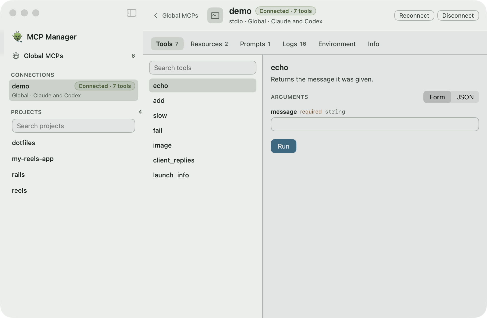

# MCP Manager

A macOS menu bar app that keeps your MCP servers in sync across **Claude Code** and **Codex**, and lets you connect to any of them to try their tools.

<picture>
  <source media="(prefers-color-scheme: dark)" srcset="assets/screenshots/main-window-dark.png">
  
</picture>

## Install

```sh
curl -fsSL https://raw.githubusercontent.com/rixcy/mcp-manager/main/install.sh | bash
```

Then open it with `mcp-manager open`, or from the menu bar. While its window is open it is a regular app, with a Dock icon and Settings on ⌘,.

**To update**, run the same command again (or `mcp-manager update`). It only rebuilds when there's something new.

Needs macOS 14+ and the Xcode Command Line Tools (`xcode-select --install`). It builds from source on your Mac, so there's nothing to notarise or unquarantine.

## What it does

- **Global MCPs:** add, edit and remove servers in Claude and Codex at once. Newest are on top; drag to reorder. A server only one of them has gets a **Sync** button.
- **Project MCPs:** search any project Claude or Codex knows about and edit its servers in the file they came from.
- **MCP client:** open a server to connect, run its tools from a form or raw JSON, read its resources, prompts and logs. Works over stdio, HTTP and SSE, and handles OAuth sign-in.

<picture>
  <source media="(prefers-color-scheme: dark)" srcset="assets/screenshots/server-dark.png">
  
</picture>

## Your configs are safe

- It edits `~/.claude.json`, `.mcp.json` and Codex's `config.toml` in place, keeping comments and unrelated settings.
- Every file is backed up to `~/Library/Application Support/MCP Manager/Backups/` before a change.
- OAuth tokens live in your login keychain. Tokens and secrets are scrubbed from the logs in `~/Library/Logs/MCP Manager/`.
- Nothing runs until you press **Connect**.

## Uninstall

```sh
rm -rf ~/Applications/"MCP Manager.app" ~/.local/share/mcp-manager ~/.local/bin/mcp-manager
```

## Develop

```sh
./install.sh            # build and install this checkout
bin/test                # core tests
bin/capture /tmp/shots  # screenshot the app in the background
MCP_MANAGER_HOME="$(bin/fixture-home "$(mktemp -d)")" mcp-manager open  # try it against sample configs
```

Plain `swiftc`, no SwiftPM or Xcode project. `Sources/Core` holds the config stores and MCP client, `Sources/App` the SwiftUI app.
